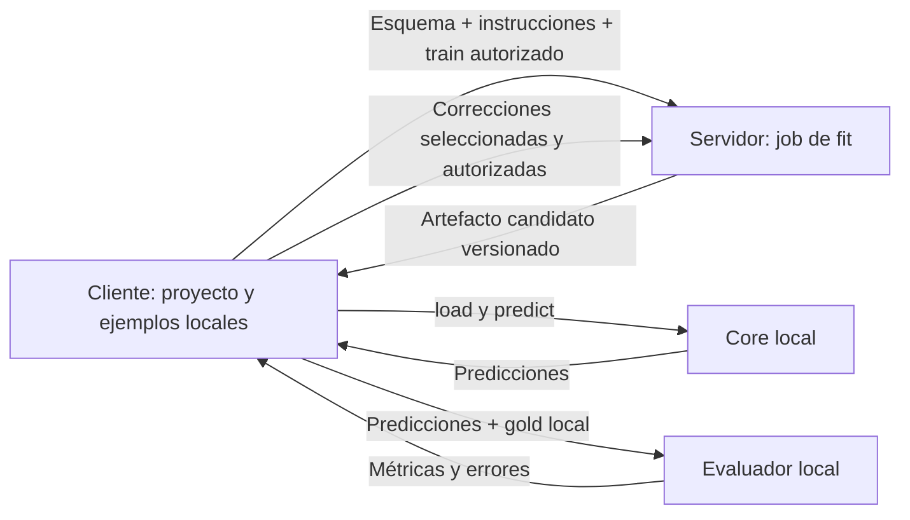

# Core, evaluación y aplicación local

Propuesta del 20 de octubre de 2026. Este documento registra la dirección del
producto y el refactor recomendado; los componentes futuros todavía no están
implementados. La prioridad sigue siendo validar el core y su inferencia en Mac.

## Qué tenemos

El contrato útil ya existe en `methods/base.py`:

```python
artifact = method.fit(train_examples, task_spec, dev_examples=None, scorer=None)
method.dump(artifact, directory)
artifact = method.load(directory)
predictions = method.predict(artifact, inputs)
metrics = score(predictions, heldout_examples)
```

`predict` recibe documentos sin gold. Los artefactos conservan el esquema y el
estado del método, y hemos comprobado la recarga en procesos nuevos. Los runs
de reglas permiten síntesis con un LLM e inferencia posterior sin LLM. Ese es el
camino más directo hacia un extractor que el cliente ejecuta localmente.

La separación actual es parcial:

| Área | Implementado | Pendiente |
|---|---|---|
| Métodos | `fit/dump/load/predict`, artefactos concretos y configuración por método | Registro común que incluya RuleChef y HardSpaCy; capacidades de runtime y refinamiento |
| Datos | Adaptador de Label Studio, selección explícita de gold y validación de posiciones | Tipos de dominio independientes de Label Studio |
| Esquema | Etiquetas de entidades/relaciones e instrucciones generales (`--instructions`) | Descripciones por etiqueta, políticas de límites y definición de proyecto en JSON |
| Evaluación | Strict/overlap, micro/macro, métricas por etiqueta y fallos incluidos | Evaluación de relaciones compartida y política de selección de candidatos |
| Ejecución | CLI y runners de experimentos; archivos locales de resultados y procedencia | Servicio común que pueda invocar una CLI, desktop o servidor |
| Iteración | Parches de RuleChef, dev explícito, coordinación y `refine` desde una copia | Contrato general de correcciones/feedback del usuario e integración en la CLI |
| Producto | Todavía CLI | Proyectos, almacenamiento local, selección de versiones y transporte de jobs |

`evaluator.py` solo puntúa; no necesita convertirse en dueño de la aplicación.
El laboratorio más amplio es `experiments/`, con selección de cohortes y
comparaciones del dataset. Esas decisiones específicas de ReumaLago deben
permanecer fuera del core reutilizable.

Hoy `data.py` mezcla dominio y Label Studio: `TrainingExample.gold` es una
`GoldAnnotation`, las predicciones usan `from_name/to_name` y el esquema se
importa desde XML. Además, `cli.py` coordina carga, selección, construcción del
método, persistencia, aprobación y evaluación. RuleChef funciona mediante su
runner específico y aún no aparece en el selector del CLI general. La descripción
clínica de RuleChef ahora está en las instrucciones del experimento/esquema;
el adaptador conserva solo el contrato de entidades y capacidades del runtime.

## Un repositorio y un paquete

Mantener un monorepo. Las responsabilidades se separan mediante módulos y
dependencias; todavía no hacen falta repositorios ni servicios independientes
para cada pieza. Cliente y servidor serán dos formas de invocar el mismo paquete.

| Responsabilidad | Qué posee |
|---|---|
| Core | Documentos, entidades, relaciones, esquema, métodos y artefactos; operaciones de fit e inferencia |
| Servicios de aplicación | Importar, crear splits, ejecutar fit, evaluar candidatos, guardar versiones y promover una versión |
| Evaluador | Puntuar predicciones contra gold y producir informes; sin UI ni selección de archivos |
| Cliente | Proyectos, anotación, prompts, consentimiento de envío, datos locales, revisión, inferencia y exportación |
| Servidor de fit | Jobs de síntesis/refinamiento, credenciales del proveedor y devolución de candidatos |
| Experimentos | Protocolos del paper, cohortes congeladas y comparaciones científicas |

Un destino posible, migrando por partes y conservando imports de compatibilidad:

```text
extractorbase/
  core/           # tipos, contratos, artefactos y métodos
  application/    # runner común, registro de métodos, splits y versiones
  adapters/       # Label Studio, archivos y otros formatos de entrada/salida
  evaluation/     # score e informes
  cli.py          # argumentos, presentación y llamadas a application
  client/         # futuro adaptador de aplicación local
  server/         # futuro adaptador HTTP/job para fit
experiments/      # protocolos concretos, fuera del producto
tests/
```

No crear todos esos directorios vacíos como primer paso. Extraer primero tipos y
orquestación, manteniendo `fit/dump/load/predict` y los comandos existentes.
Cambiar `Method` de nombre puede esperar; no resuelve el acoplamiento actual.

## Esquema definido por el usuario

Guardar la definición del proyecto en JSON independiente del XML de anotación.
Para la primera versión, el alcance debe ser texto con entidades ancladas a
posiciones y relaciones entre entidades. Una salida JSON arbitraria y anidada
necesitaría otro contrato y otras métricas; no está implementada por declarar
más etiquetas.

Cada etiqueta necesita un identificador estable, nombre visible, descripción y
convención de límites. Puede incluir ejemplos positivos/negativos; por ejemplo,
si una prueba incluye su valor o unidad y qué abreviaturas pertenecen a ella.
Las instrucciones generales del usuario se aplican desde la primera síntesis y
se guardan con la versión del esquema. Ya existe el campo general
`TaskSpec.instructions`; faltan los campos estructurados por etiqueta.

El modelo interno debería ser `Document`, `Entity`, `Relation`, `Annotation`,
`Prediction` y `TaskSpec`, sin autores de Label Studio ni nombres de controles.
Label Studio queda como adaptador de importación/exportación; puede seguir
sirviendo para anotar mientras se prueba el core. Una UI propia solo tendrá que
producir esos mismos objetos.

Conservar texto original e intervalos `[start, end)` en posiciones Unicode de
Python. Una UI JavaScript debe convertir sus posiciones UTF-16 explícitamente.
Cambiar espacios, HTML o normalización del texto después de anotar altera las
posiciones y requiere una transformación registrada, no una corrección implícita.

## Flujo local y servidor de fit



La validación es una política opcional del mismo flujo. Con pocos ejemplos se
pueden usar todos para enseñar y revisar los casos conocidos; si se elige una
validación separada, el cliente crea y conserva el split antes del envío. El
servidor recibe los ejemplos autorizados, el esquema y las instrucciones. Para
revisión recibe también el artefacto base; un ID solo basta si su contenido sigue
disponible y verificable. El cliente evalúa el candidato y decide si promueve la
versión. No hace falta enviar los textos del heldout para puntuar localmente.

Modos propuestos, todavía sin flags implementadas:

| `validation` | Datos usados para fit | Qué significa la evaluación |
|---|---|---|
| `none` | Todos los ejemplos entregados para aprender | Preview/regresión sobre casos conocidos; no estima notas nuevas |
| `split` | Subconjunto fijado por el cliente antes de fit | Dev local sobre ejemplos apartados |
| `provided` | Todos los ejemplos de train | Evaluación sobre otro conjunto aportado explícitamente |

El servidor puede ejecutar sus parches internos sobre train y devolver un
candidato al terminar el job. El usuario lo revisa, prueba y solicita otra
revisión cuando quiera. No hace falta una ida y vuelta por cada parche interno.
La selección automática con evaluación local entre candidatos puede añadirse
después mediante el mismo core. Devolver métricas al fitter para guiar reglas
convierte el conjunto local en dev adaptativo, aunque no se envíen sus textos.

Los documentos de producción y sus resultados se guardan en el cliente. El
servidor necesita un espacio temporal para los ejemplos enviados y el job; eso
no lo convierte en el almacén de proyectos, anotaciones o predicciones locales.
Las trazas del experimento que contienen notas no forman parte del paquete de
inferencia que se entrega al cliente.

Para una primera aplicación local, reutilizar la CLI como proceso de backend es
una opción suficiente. Antes conviene añadir una salida JSON/eventos para que
la UI no interprete tablas Rich. Una web con inferencia completamente en el
navegador tiene otra restricción: nuestras regex de Python y sus lookbehinds no
son automáticamente equivalentes a regex JavaScript. Un artefacto JSON no hace
portable por sí solo el motor que lo ejecuta.

## Iteración con el usuario: requisito registrado

1. El usuario crea proyecto, estructura, descripciones e instrucciones, y aporta
   ejemplos anotados. Elige enseñar con todos o usar validación separada; el
   cliente fija el split cuando corresponda. Un test final independiente puede
   añadirse cuando haya datos y se necesite estimar generalización.
2. Fit propone un artefacto candidato. El cliente lo carga y evalúa; distingue
   preview de train y resultados de validación, y muestra errores, métricas
   globales y por etiqueta, coste y requisitos del runtime.
3. El usuario corrige anotaciones o escribe feedback: «este caso debe extraer
   solo X», «esta abreviatura significa Y», etc. El feedback se vincula a un
   ejemplo, etiqueta/regla opcional, esquema y versión base.
4. El cliente puede sugerir una muestra de errores. El usuario ve y autoriza
   qué ejemplos concretos se envían para una nueva síntesis/refinamiento.
5. El servidor reutiliza el backend de síntesis, ahora con la versión base,
   correcciones e instrucciones. Devuelve otro candidato; no reemplaza la
   versión activa del cliente.
6. El cliente compara candidato e incumbente con la misma política y los mismos
   ejemplos de evaluación. Promueve el candidato si cumple la política elegida
   y el usuario lo acepta. Sin validación separada, esa decisión sigue siendo
   revisión/regresión sobre ejemplos conocidos. Conserva el incumbente si se
   rechaza; permite volver a versiones anteriores y registra la decisión.

La selección debe ser explícita y propiedad de la aplicación: métrica objetivo
del proyecto, fallos de inferencia y posibles límites por etiqueta. No confundir
«mejor macro», «mejor micro» y «más precisión». RuleChef usa otra política interna
para sus parches; la publicación del candidato no debe depender solo de ella.

Un ejemplo enviado al sintetizador deja de ser heldout para ese candidato. Si
se promociona un error de dev a train, versionar el split y reevaluar tanto el
incumbente como el candidato en el dev restante. El test final no alimenta ese
bucle. Reutilizar dev para elegir versiones también lo convierte en una medida
adaptativa; no equivale a una estimación final independiente.

Con diez ejemplos, una partición pequeña puede no cubrir categorías raras.
Permitir splits explícitos y reportar su soporte; un preview sobre train debe
seguir llamándose preview de entrenamiento. No dejar que la librería cambie
silenciosamente a validación sobre train por tener pocos ejemplos.

El flujo puede comenzar con un nuevo `fit` por revisión y comparación externa.
Después, los métodos que lo soporten pueden añadir una operación opcional
`refine(base_artifact, examples, feedback, task_spec)`. Reutilizar síntesis,
validación, persistencia y evaluación; no imponer un agente general ni un
optimizador común a BERT, reglas y prompts.

## Artefactos y datos locales

Introducir un manifiesto común alrededor del estado específico de cada método:
versión de formato, método/configuración, esquema y hash, versión padre,
requisitos reales de inferencia, hashes de archivos y procedencia de selección.
Separar el payload de inferencia de ejemplos, trazas, métricas detalladas y
credenciales de fit. Mantener los formatos actuales mediante migración explícita.

Los dos pilotos anteriores, aunque solo contienen regex, aún declaran un pipeline
spaCy y su formato antiguo lo carga. El export nuevo basa ese requisito en las
reglas efectivas y conserva el modelo permitido durante fit como procedencia
separada. Los artefactos congelados de los pilotos no se han modificado.
También conviene cargar dependencias de síntesis solo durante fit, para que
inferencia no necesite configurar un proveedor de LLM.

Para la PoC bastan carpetas locales por proyecto, con definición/esquema,
ejemplos, splits versionados, artefactos por versión, ejecuciones/predicciones,
métricas y feedback. Cada ejecución referencia la versión exacta de extractor
y esquema. La aplicación del cliente posee esos archivos; una base de datos
no es un requisito para el siguiente paso.

## Orden recomendado

1. **Cerrar la PoC del core:** cargar un artefacto congelado en Mac Studio,
   ejecutar sin síntesis ni credenciales de LLM y comparar predicciones con
   Linux. Medir tiempo/RSS y registrar versiones. El export nuevo ya evita cargar
   modelos spaCy cuando solo contiene regex. La inferencia de Mac no necesita
   bubblewrap, que protege la síntesis del servidor Linux.
2. **Refactor pequeño:** tipos neutrales + adaptador Label Studio; runner y
   registro compartidos por CLI/experimentos; manifiesto y requisitos de runtime.
   Mantener regresiones de posiciones, selección de gold y recarga.
3. **Fit revisable desde CLI:** instrucciones iniciales y por etiqueta, split
   explícito, candidatos versionados y aceptación local; añadir correcciones y
   feedback conservando el incumbente.
4. **Cliente/servidor finos:** envolver ese mismo flujo en jobs de fit y una UI
   local con proyectos, anotación, consentimiento, selección de versión y export.

La investigación de calidad sigue en paralelo: elegir ejemplos que cubran mejor
las etiquetas y variantes, definir límites por clase y comparar revisiones con
dev separado. No convertir la cohorte exploratoria actual de 789 notas en el
criterio de aceptación de un producto.

La justificación de los modos opcionales, evidencia publicada y un experimento
para comparar veinte ejemplos de train frente a un split están en
[validation-policy.md](validation-policy.md).

La auditoría de reglas y la evidencia de la brecha con el paper están en
[rulechef-paper-audit.md](methods/rulechef-paper-audit.md).

## Observation mode y baselines futuros

Añadir después de la PoC del core un modo de aprendizaje por observación:
guardar, con autorización, pares entrada/salida del modelo que ya resuelve la
tarea; sintetizar periódicamente candidatos con esas pseudoetiquetas;
validarlos en ejemplos revisados por personas y devolver una versión al cliente.
Las pseudoetiquetas deben registrar modelo, prompt y versión; acuerdo con el
profesor no equivale a calidad contra gold humano. El consentimiento y la
retención siguen la política local del cliente y los jobs temporales del server.

El cliente puede resolver con reglas los casos que superen una política de
precisión/cobertura y abstenerse en el resto, o usar fallback LLM si ese proyecto
lo permite explícitamente. Mantener el modo determinista sin fallback como
opción. Medir cobertura de notas/entidades y sustitución real de llamadas por
separado: acertar algunas entidades de una nota no permite saltar la llamada
entera. No trasladar directamente la cobertura de clasificación de Banking77
a extracción clínica. La idea está en el
[modo de observación de RuleChef](https://arxiv.org/html/2607.01293v1#S3.SS3).

Considerar NLI como baseline de clasificación de candidatos, no como sustituto
directo de NER. El DeBERTa citado por RuleChef es inglés y su ficha incluye
Banking77 en el entrenamiento; no tomar su 96,5% como garantía de zero-shot en
nuestra tarea. Comparar candidatos, español, offsets y coste en un protocolo
propio. Véase [la auditoría experimental](methods/rulechef-experiments.md).
